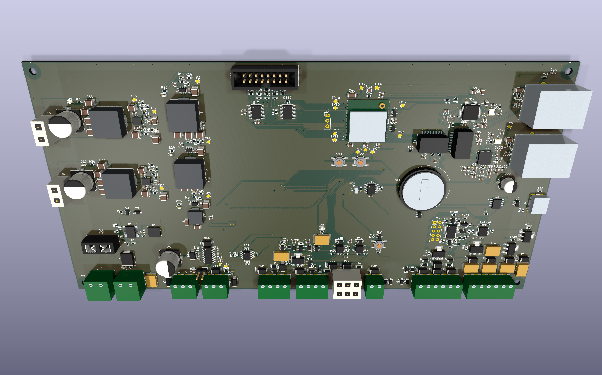

# МСО74 — четвёртый заход, финальная доводка трассировки

## Итог

Закрыты все 18 оставшихся связей снимка `route-state` **7883e15a34a5df95347993e466ea9fff9532ce28** (rest №2).
Готовая плата: [`plata/kicad/routed/mso74-plata.kicad_pcb`](../kicad/routed/mso74-plata.kicad_pcb), рядом её `.kicad_pro` и `.kicad_dru`.
**KiCad 9.0.9: 0 неразведённых, 0 новых ошибок, 0 via_dangling/track_dangling, 0 copper_sliver.**
Сохраняются четыре разрешённые заданием ошибки отверстий J5; 371 замечание шелкографии вынесено отдельно.
Это кандидат для проверки перед заказом с явно перечисленными ниже остаточными ограничениями, а не подтверждение испытаний железа.

Основа ветки `route/final-codex` — main **c8f20e1**, PR #56. Схема, раскладка, библиотеки, правила `pcb_rules.py` и workflow не изменены. Центры и повороты всех компонентов сохранены. В `main` и `route-state` изменения не вносятся.

## Что доразведено

Размеры в таблице — миллиметры. Для многослойной ветви указаны выводы на F и основная часть. Длина — сумма добавленной меди между площадками, без вертикальной длины via; для присоединения к прежнему стволу это длина новой ветви, а не всей цепи. Полная детализация — [routes.md](codex_route_final/routes.md), UUID — [changes.json](codex_route_final/changes.json).

| Остаток снимка | Исполнение | Слой / ширина | Длина добавленного участка | Результат |
|---|---|---|---|---|
| VIN_F ×4 | C1.1 к F1.2; R1.1 к F1.2; U1.6 к R1.1; Q2.2 к F1.2 | C1: F/B 0,60; R1/Q2: F/B 0,25; IN_SYS: F 0,15 | 8,121 / 5,505 / 12,070 / 18,666 | Все четыре разрыва закрыты. Узкие участки относятся к sense/управлению; силовой ствол сохранён |
| VIN_B ×2 | Три исходные зоны объединены точным контуром; мешающие EF_PGTH/EF_SHDN убраны с F | F, полигон | Полигон вместо проволочной перемычки | Q1 drain, U1 VIN и C3 соединены заливкой |
| ETH_1V2 | U10.22 → C60.1 | F 0,20 + In2 0,20 + F 0,20; два via | 5,425 | Соединено |
| ETH_TOCAP | U10.20 → C59.1 | F 0,15 + In2 0,20 + F 0,20; два via | 10,290 | Соединено |
| LCD1_RT / LCD2_RT | U5.6 → R28.1; U6.6 → R35.1 | F/B/F 0,20 | 28,865 / 28,752 | Соединено; обход готовой меди без изменения силовых ячеек |
| +5V_LCD1 | TP6 → R30.1 | F/B 0,20 | 8,151 | Тестовая ветвь, не силовой вывод табло |
| +5V_LCD2 | Оставшийся fanout TP7 → R37.1 | B 0,20, исходный via использован | 19,714 новой меди | Тестовая ветвь; бывший висящий via теперь соединён |
| USB_VBUS ×2 | U9.5 → J5.A4 и A4 → A9 | F/B/F 0,20; перемычка у J5 на F 0,20 | 7,977 / 14,812 | Обе связи закрыты; NPTH USB учитываются как отверстия на всех слоях |
| +12V_T | D27.1 → J12.2 | F 0,60 | 14,477 | Соединено |
| EF_BGATE | U1.4 → Q1.4 и Q2.3; вместе восстановлены DRV/PGTH/SHDN | Выходы F 0,15–0,20, деревья In2 0,20 | Ветки BGATE на In2 16,127 + 8,370; полный перечень в routes.md | Соединено, коридор VIN_B освобождён |
| SW_VCORE | Незавершённый выход TP8 → существующее закреплённое дерево | F 0,20 + In2 0,30; via 0,45/0,20 | 3,847 + 16,139 | Соединено. Сам U22 и его обвязка уже имели питание в исходном снимке |
| HUBB_C | R85.1 → U18.18 | F/In2/F 0,20; два via | 14,221 | Соединено; локальное отступление по слою описано ниже |

### Почему не соединялись зоны VIN_B

В исходном снимке `U1:VIN`, `Q1-U1:VIN-top`, `Q1:drain` имеют разные приоритеты. После заливки между ними оставались коридоры. Через эти коридоры Freerouting провёл управляющие сети на F; затем они вырезали зазор и в объединённой зоне. Поэтому одной смены приоритета недостаточно.

Примеры исходных отрезков, координаты локальные, без файлового смещения +30 мм:

- EF_PGTH, UUID `72f8fd55-18de-496c-9fd3-33f787236fc1`: (27,9172; 78,958) → (38,4621; 78,958), F, 0,20 мм.
- EF_SHDN, UUID `4a875583-44d3-473f-ab4e-f5ff4e08d98d`: (40,3013; 83,175) → (40,3013; 75,951), F, 0,20 мм.

Теперь одна зона `MSO74_PREROUTE_V1:Q1-U1:VIN`, приоритет 12. Её вершины: (29,4;76), (49,4;76), (49,4;86,4), (44,1;86,4), (44,1;80,2), (31,9;80,2), (31,9;82,9), (29,4;82,9). Это объединение прежних прямоугольников, без заполнения лишнего bounding box. Управление U1 перенесено на ручные закреплённые деревья In2. Последующая заливка и DRC подтверждают физическое соединение VIN_B, а не только одинаковое имя net.

### Слои и отступления

In1 сохраняется землёй: на нём нет сигнальных дорожек. На In2 добавлены только явно заданные локальные цепи управления U1, конденсаторы W5500, присоединение TP8 и HUBB_C. Freerouting не получает разрешения трассировать остальные сигналы на этом слое.

HUBB_C — адрес строки табло. Свободный проход на F/B в готовой разводке не найден, поэтому применён In2; это осознанное отступление от исходного назначения слоя питания. Это не Ethernet, USB или CLK. Новая ветвь короткая (14,221 мм суммарно), исходные соединения плоскости +3V3 не потеряны (DRC: 0 неразведённых). Целостность фронтов на реальном табло здесь не измерялась.

TP8 перенесён с незавершённого выхода на новый via (214,4; 32,8). Новая ветвь In2 обходит проекцию B-пар Ethernet; добавленные via W5500 также отнесены от них. Поиск использует виртуальные препятствия вдоль B Ethernet/USB; отдельная проверка пересечения проекций добавленной меди с учётом 0,30 мм выреза заливки дала 0 пересечений. Это геометрическая проверка новых вырезов, не моделирование импеданса всей платы. Исходные Ethernet/USB не переразведены и не укорачивались.

RT пришлось обойти по B вокруг сохранённой меди: длины около 28,8 мм не являются компактным идеалом для частотозадающей цепи. Этот проход подтверждает соединение и геометрические зазоры; чувствительность частоты к помехам и работу преобразователей надо проверить при включении образца. Для сокращения этих цепей в следующей ревизии следует закреплять RT до общей автотрассировки; на свежем init обновлённый скрипт соединяет их на F.

## Изменения относительно route-state

Машиночитаемый перечень удалений и всех добавлений: [changes.json](codex_route_final/changes.json). Контроль сравнения: [verification.json](codex_route_final/verification.json), скрипт — [verify.py](codex_route_final/verify.py).

| Объекты | Изменение |
|---|---|
| Исходные дорожки/via | 3991 → 4112 объектов |
| Сохранено исходных UUID | 3937; геометрия 3936 неизменна |
| Один исходный via IN_SYS | `bb2a6ca2-1fe2-47c4-896d-4805b344bf7d`, локально (29,5;84,325): 0,60/0,30 → 0,45/0,20; это измерительная ветвь VIN_F, не силовой переход |
| Удалены мешающие/незавершённые объекты | 54: EF_BGATE 8, EF_DRV 15, EF_PGTH 14, EF_SHDN 8, HUBB_C 5, незавершённый TP8/SW_VCORE 3, лишний via ETH_LED_G 1 |
| Добавлена медь | 147 сегментов + 28 via; всё новое закреплено; минимальная новая дорожка 0,15 мм |
| VIN_B | Три зоны → одна; два UUID зон удалены, у оставшейся изменён контур и имя |
| Остальные зоны | Повторно залиты с учётом новой меди; заполненные полигоны закономерно изменились |
| Компоненты | 390 посадочных мест, положения/повороты/площадки/назначения сетей неизменны; 386 компонентов проверены против нетлиста, NC обрабатываются как в pcb_build |
| Тепловая медь | 15 PTH EP21 U1 сохранены; исходные закреплённые тепловые via не удалялись |
| Ethernet/USB | Вся исходная медь этих классов, включая via, сохранена по UUID и геометрии |

Пять исходных висящих via обработаны по смыслу: +5V_LCD2 присоединён; лишний ETH_LED_G удалён; незавершённые EF_DRV и HUBB_C заменены вместе с мешавшими ветвями; TP8 заменён выходом с обходом опорных коридоров. Удалён также микроскопический незавершённый отрезок EF_DRV. Итоговая проверка dangling — 0.

## Воспроизводимость

Общие рецепты добавлены в `pcb_preroute.py`: объединённая зона VIN_B, обязательная мелкая обвязка, деревья U1, RT, PHY-конденсаторы, VBUS, тестовые ветви, +12V_T и HUBB_C. Проверка препятствий дополнена реальными NPTH: один слой маски площадки не должен скрывать сквозное механическое отверстие.

Для данного снимка добавлен `pcb_finish.py`: это отдельная доводка существующей разводки с защитой закреплённых силовых зон. Скрипт привязан к снимку 7883e15 и проверяет три ожидаемые исходные зоны; не предназначен для произвольного повторного применения к уже готовому результату.

```sh
python3 plata/kicad/gen/pcb_finish.py route-state/mso74-plata.kicad_pcb out/mso74-plata.kicad_pcb
kicad-cli pcb drc --format json --severity-all --all-track-errors \
  --output out/drc.json out/mso74-plata.kicad_pcb
```

Два независимых запуска доводки на одном исходном снимке дали одинаковую геометрию дорожек/via и заполненной меди всех зон. SHA-256 нормализованной меди: `04452d473c9d309296c8ee71ec8a7715c0cf3c40a6c3848a577cf33b2c91f423`. Сравнение не зависит от дат сохранения. Все добавления закреплены; исходные незакреплённые дорожки Freerouting не объявлялись вновь закреплёнными.

Дополнительно выполнена полная свежая сборка `netlist → pcb_build → init → pcb_preroute`: код возврата 0, создан 1901 объект, невыполненных локальных рецептов 0. DRC 9.0.9 показал те же четыре J5 и 371 шелкографию, без новых нарушений меди. На этой стадии до Freerouting остаётся 279 общих связей — это **не** результат финальной платы с нулём связей. Подробности и пары: [fresh-init.json](codex_route_final/fresh-init.json).

Геометрия формировалась системным pcbnew 9.0.2, окончательный DRC выполнен отдельным **kicad-cli 9.0.9** с настройками из каталога готовой платы. Правила/исключения не ослаблялись. Свежий init с предразводкой и окончательно разведённый снимок — разные стадии: сохранённый кандидат содержит также прежнюю работу Freerouting.

## Итог DRC

Отчёт проверялся на конечном пути `plata/kicad/routed/mso74-plata.kicad_pcb`, вместе с одноимёнными `.kicad_pro` и `.kicad_dru`. Исходный JSON: [drc.json](codex_route_final/drc.json).

| Проверка KiCad 9.0.9, все серьёзности и все ошибки дорожек | Итог |
|---|---:|
| Unconnected items | **0** |
| Новые ошибки меди/зазоров/края/ширины | **0** |
| via_dangling / track_dangling | **0 / 0** |
| zones_intersect / copper_sliver | **0 / 0** |
| Известные hole_clearance J5 | **4** |
| silk_overlap | 184 |
| silk_over_copper | 161 |
| silk_edge_clearance | 26 |
| Всего записей violations | 375 |

Четыре J5: A1/B12 и A12/B1 относительно двух механических NPTH; фактически 0,1847 мм при требовании 0,2000 мм. Пары площадок перекрываются штатно, поэтому две физические области дают четыре записи. Посадочное место не урезалось без проверки чертежа разъёма; разрешённые заданием исключения сохранены без изменения правил. В абсолютном смысле DRC **не равен нулю ошибок**: эти четыре остаются. Перед передачей изготовителю надо отдельно решить их приёмку либо корректировку по чертежу.

Независимая проверка физического контакта форм меди и каждого отдельного фрагмента заливки также прошла: 11 Ethernet-пар, USB, средние точки, экранные RC, U22 CORE/VDD и все 366 GND-via; [connectivity.json](codex_route_final/connectivity.json), использован существующий [connectivity.py](codex_preroute/connectivity.py). Это проверка проводимости по геометрии, не проверка функциональности схемы.

Полный отдельный список шелкографии, с объектами и координатами: [silkscreen.md](codex_route_final/silkscreen.md). Шелкография здесь не исправлялась и по заданию не блокирует этот проход.

## Изображения

Четыре полных медных слоя, с заливками и контуром платы:

| Слой | PDF | PNG |
|---|---|---|
| F.Cu | [вектор](codex_route_final/F.Cu.pdf) | [изображение](codex_route_final/F.Cu.png) |
| In1.Cu | [вектор](codex_route_final/In1.Cu.pdf) | [изображение](codex_route_final/In1.Cu.png) |
| In2.Cu | [вектор](codex_route_final/In2.Cu.pdf) | [изображение](codex_route_final/In2.Cu.png) |
| B.Cu | [вектор](codex_route_final/B.Cu.pdf) | [изображение](codex_route_final/B.Cu.png) |

Дополнительные увеличения: [силовые узлы F](codex_route_final/power.png), [Ethernet F](codex_route_final/signals.png), [Ethernet B](codex_route_final/signals-B.png). Только у этих увеличений временно скрыта внешняя заливка GND, чтобы видеть соединения; это изображения, не файлы для DRC или производства.



3D создан штатным рендерером KiCad по копии итоговой платы. Недостающие модели корпусов заменены приблизительными геометрическими телами, DNP не установлены. Это визуализация размещения, не проверка механических коллизий по точным STEP. В производственную плату пути к временным моделям и сами приблизительные модели не добавлены. Рендерер записал и подтвердил PNG, затем завершился с сигналом при очистке процесса; сохранённый PNG открыт и визуально проверен. Экспорт слоёв и DRC завершились штатно.

## Что этим проходом не проверялось

- Тепловые испытания, работа питания под нагрузкой, КЗ, ЭМС и реальные уровни интерфейсов: физического образца нет.
- Импеданс/джиттер/отражения и поведение длинных RT-ветвей: здесь только геометрия, соединение и сохранение ранее подготовленных пар.
- Механическая корректность исключений J5 и точные 3D-корпуса отсутствующих моделей.
- Gerber, сверловка, BOM/PnP и технологический приём JLCPCB не являются результатом этого прохода; кандидат сохранён в исходном формате KiCad.
